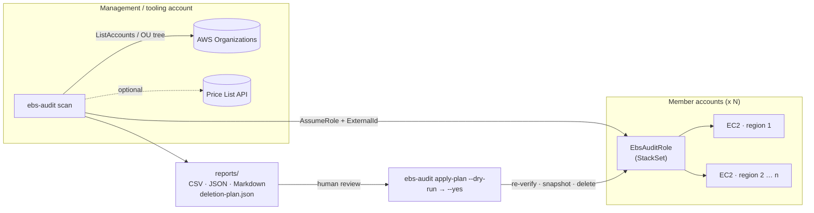

# ebs-audit: unattached EBS volume finder for AWS Organizations

[](../../actions/workflows/ci.yml)


A Python / Boto3 tool that **finds every unattached EBS volume older than N days in every account of an AWS Organization**, estimates what each one costs, writes **CSV / JSON / Markdown reports**, and can produce a **safe, reviewable deletion plan**.

> **Code Clinic – Challenge #3 (Cloud Infrastructure & Provisioning).**
> *Build a Python script using Boto3 that discovers all unattached EBS volumes older than N days across accounts (via Organizations) and generates a cost report + optional deletion plan.*

---

## Table of contents

- [Why](#why)
- [Features](#features)
- [Architecture](#architecture)
- [Prerequisites](#prerequisites)
- [Installation](#installation)
- [Quick start](#quick-start)
- [Usage](#usage)
- [Sample output](#sample-output)
- [How costs are estimated](#how-costs-are-estimated)
- [Deletion plan safety model](#deletion-plan-safety-model)
- [IAM setup](#iam-setup)
- [Security considerations](#security-considerations)
- [Idempotency notes](#idempotency-notes)
- [Testing](#testing)
- [CI pipeline](#ci-pipeline)
- [Running on a schedule](#running-on-a-schedule)
- [Project layout](#project-layout)
- [Limitations](#limitations)

---

## Why

Detached EBS volumes are among the most common sources of cloud waste. They keep billing after the instance is gone, nobody owns them, and they're spread across dozens of accounts and regions. A single forgotten 1 TiB `io2` volume with 16k IOPS costs about **$1,165/month**.

## Features

| | |
|---|---|
| **Organization-wide** | Lists ACTIVE accounts through AWS Organizations: the whole org, specific OUs (recursive), or an explicit account list. |
| **Cross-account** | `sts:AssumeRole` into a least-privilege role in each account, with optional **ExternalId**. Sessions and clients are cached and thread-safe. |
| **Every enabled region** | Discovers enabled regions per account, including opt-in regions, or takes a fixed list. Works in the `aws`, `aws-us-gov` and `aws-cn` partitions. |
| **Fast** | Scans account/region pairs in parallel with a configurable thread pool, adaptive retries and server-side filtering (`status=available`). |
| **Cost report** | Monthly and annual estimates per volume, including gp3/io1/io2 provisioned IOPS and throughput. Price overrides via JSON or the live AWS Price List API. |
| **Reports** | CSV for spreadsheets, JSON for pipelines, and a Markdown summary for humans and PR comments. |
| **Protect tags** | Volumes tagged `DoNotDelete` or `ebs-audit:keep` (configurable) are reported but **never** planned for deletion. |
| **Deletion plan** | Reviewable JSON with a checksum, expiry and snapshot cost estimate. Applying it is a separate, explicit command with `--dry-run`. |
| **Safe apply** | Re-checks every volume before acting, snapshots before deleting, and re-uses snapshots on retry. One failure never stops the run. |
| **Resilient** | `AccessDenied` in one account or region is recorded in the report and the scan carries on. Exit code `2` signals partial results. |

## Architecture



**Code structure** (all business logic is boto3-free and unit-tested with fakes):

| Module | Responsibility |
|---|---|
| `aws.py` | The **only** module that imports boto3: `SessionFactory` (AssumeRole, partitions, caching, retries) |
| `accounts.py` | Organizations discovery (whole org or OU subtree), ACTIVE filter, include/exclude |
| `scanner.py` | Region discovery, `describe_volumes` pagination, age filter, protection, parallel fan-out, error capture |
| `pricing.py` | `PriceBook` (defaults, overrides, tiered IOPS), live Price List API lookups |
| `report.py` | CSV / JSON / Markdown writers |
| `plan.py` | Build, checksum, verify and apply deletion plans |
| `cli.py` | `argparse` CLI, logging (text or JSON), exit codes, confirmation prompt |

## Prerequisites

| Requirement | Notes |
|---|---|
| Python | 3.10 – 3.13 |
| Credentials | Run from the **Organizations management account** or a **delegated administrator** account (needed for `ListAccounts`). Use `--accounts` or `--no-org` otherwise. |
| Member role | A role in each member account that the runner can assume. Use the provided [StackSet template](iam/member-role-stackset.yaml) to create `EbsAuditRole`. |
| Network | HTTPS to the AWS APIs (`sts`, `organizations`, `ec2`, optionally `pricing`) |

## Installation

```bash
git clone https://github.com/ngems1/sdk-boto3.git
cd sdk-boto3
python -m venv .venv && source .venv/bin/activate     # Windows: .venv\Scripts\activate
pip install .            # or: pip install -e ".[dev]" for development
ebs-audit --version
```

Or with Docker:

```bash
docker build -t ebs-audit .
docker run --rm -v ~/.aws:/home/app/.aws:ro -e AWS_PROFILE=mgmt -v "$PWD/reports:/reports" ebs-audit scan
```

## Quick start

```bash
# 1. Report only: whole organization, every enabled region, volumes older than 30 days
ebs-audit --profile org-mgmt scan --external-id "$EXTERNAL_ID"

# 2. Report + deletion plan
ebs-audit --profile org-mgmt scan --min-age-days 60 --plan --external-id "$EXTERNAL_ID"

# 3. Review reports/*.md and reports/deletion-plan.json, then check permissions without changing anything
ebs-audit --profile org-mgmt apply-plan reports/deletion-plan.json --dry-run --external-id "$EXTERNAL_ID"

# 4. Execute (asks you to type 'delete'; each volume is snapshotted first)
ebs-audit --profile org-mgmt apply-plan reports/deletion-plan.json --external-id "$EXTERNAL_ID"
```

## Usage

```text
ebs-audit [--profile P] [--log-level INFO] [--log-format text|json] {scan,apply-plan} ...
```

### `scan`

| Option | Default | Description |
|---|---|---|
| `--min-age-days N` | `30` | Only volumes created at least N days ago |
| `--no-org` | | Scan only the current account (no Organizations calls) |
| `--accounts 1,2` | | Explicit account IDs (skips org listing) |
| `--ou-ids ou-a,ou-b` | | Only accounts under these OUs (recursive) |
| `--exclude-accounts 1,2` | | Skip accounts (e.g. log archive, security) |
| `--regions r1,r2` | all enabled | Limit regions |
| `--home-region` | `us-east-1` | Region used for region discovery (`us-gov-west-1`, `cn-north-1`, …) |
| `--role-name` | `EbsAuditRole` | Role assumed in member accounts |
| `--external-id` | | ExternalId for the role trust policy |
| `--assume-in-caller-account` | off | Also assume the role in the account running the tool |
| `--protect-tag KEY` | `DoNotDelete`, `ebs-audit:keep` | Extra protect tag keys (repeatable) |
| `--price-file F` | | JSON price overrides ([example](examples/prices.json)) |
| `--live-pricing` | off | Per-region $/GB-month from the Price List API |
| `--output-dir D` | `reports` | Where reports go |
| `--formats csv,json,md` | all | Output formats |
| `--plan` | off | Also write `deletion-plan.json` |
| `--no-snapshot` | off | Plan deletes **without** a backup snapshot |
| `--plan-expiry-hours` | `72` | Plan validity |
| `--fail-on-findings` | off | Exit `3` if deletable volumes exist (compliance gates) |
| `--max-workers` | `16` | Parallel account/region scans |

### `apply-plan`

| Option | Description |
|---|---|
| `PLAN_FILE` | Path to `deletion-plan.json` |
| `--dry-run` | Re-verify every volume and call `DeleteVolume` with `DryRun=True`; changes nothing |
| `--yes` | Skip the interactive confirmation (for automation, after review) |
| `--no-wait` | Don't wait for snapshots to complete before deleting |
| `--protect-tag KEY` | Extra protect tags checked again at apply time |

### Exit codes

| Code | Meaning |
|---|---|
| `0` | Success |
| `1` | Fatal error (bad credentials, invalid / expired / tampered plan, aborted) |
| `2` | Partial: some accounts or regions couldn't be scanned, or some deletions failed |
| `3` | `--fail-on-findings` and deletable volumes were found |

## Sample output

Generated from a simulated three-account organization. See [`examples/`](examples) for the [full report](examples/sample-report.md), the [CSV](examples/sample-report.csv) and the [deletion plan](examples/sample-deletion-plan.json).

| Metric | Value |
|---|---|
| Accounts scanned | 3 |
| Unattached volumes | 6 |
| Total size | 3,850 GiB |
| Estimated monthly cost | $1,349.00 |
| Estimated annual cost | $16,188.00 |
| Protected (excluded from plan) | 1 |
| Potential monthly savings | $1,329.00 |
| Scan errors | 1 |

## How costs are estimated

```
monthly = size_GiB × $/GB-month
        + billable_IOPS × $/IOPS-month        (gp3 above 3,000; io1 all; io2 tiered 32k / 64k)
        + billable_MiB/s × $/MiBps-month     (gp3 above 125 MiB/s)
```

- Defaults are **us-east-1 on-demand list prices** (gp2 $0.10, gp3 $0.08, io1/io2 $0.125, st1 $0.045, sc1 $0.015 per GB-month). Other regions are typically 0–30% higher.
- Use `--live-pricing` for real per-region storage prices, or `--price-file` for negotiated or EDP rates.
- The plan shows the **snapshot cost upper bound** (full volume size × $0.05/GB-month). Real snapshots are incremental and often much smaller.

## Deletion plan safety model

Deleting data is irreversible, so the workflow has several layers:

1. **Separate steps.** `scan` never changes anything. Deletion only happens through `apply-plan`.
2. **Human review.** The plan is a readable JSON file listing every volume, action and cost. Commit it to a PR for four-eyes review if you like.
3. **Tamper-evident.** A SHA-256 checksum covers the whole plan. Adding, removing or editing entries invalidates it, and `apply-plan` refuses.
4. **Expiry.** Plans expire after 72 hours by default, so a stale plan can't be applied months later.
5. **Re-verification.** Right before acting, each volume must still exist, still be `available` with no attachments, have the same size and type, and carry no protect tag. Otherwise it's skipped.
6. **Dry run.** `--dry-run` calls `DeleteVolume` with `DryRun=True` to prove permissions without deleting.
7. **Backup snapshot.** By default each volume is snapshotted (tagged `ebs-audit:source-volume` and `ebs-audit:plan-id`), and the tool waits for the snapshot to complete before deleting.
8. **Confirmation.** Interactive runs require typing `delete`. Non-interactive runs require `--yes`.
9. **IAM guardrail.** The delete policy only allows `DeleteVolume` on volumes that carry neither `DoNotDelete` nor `ebs-audit:keep`, so protected volumes are safe even if the tool had a bug.
10. **Audit trail.** Every apply writes `reports/apply-<timestamp>.json`, and every API call appears in CloudTrail under the role session name `ebs-audit`.

## IAM setup

| File | Where | Purpose |
|---|---|---|
| [`iam/management-account-policy.json`](iam/management-account-policy.json) | Runner role (management / delegated admin) | List accounts, assume `EbsAuditRole`, optional pricing |
| [`iam/member-role-stackset.yaml`](iam/member-role-stackset.yaml) | Every member account (StackSet) | Creates `EbsAuditRole`, trusted only by the runner role **and** an ExternalId |
| [`iam/member-read-policy.json`](iam/member-read-policy.json) | Member role | Read-only: `ec2:DescribeRegions`, `ec2:DescribeVolumes` |
| [`iam/member-delete-policy.json`](iam/member-delete-policy.json) | Member role (only if you'll apply plans) | Snapshot, tag new snapshots, delete **unprotected** volumes |

Deploy the member role to the whole organization:

```bash
aws cloudformation create-stack-set \
  --stack-set-name ebs-audit-role \
  --template-body file://iam/member-role-stackset.yaml \
  --permission-model SERVICE_MANAGED \
  --auto-deployment Enabled=true,RetainStacksOnAccountRemoval=false \
  --capabilities CAPABILITY_NAMED_IAM \
  --parameters ParameterKey=TrustedPrincipalArn,ParameterValue=arn:aws:iam::111122223333:role/ebs-audit-runner \
               ParameterKey=ExternalId,ParameterValue="$EXTERNAL_ID" \
               ParameterKey=AllowDeletion,ParameterValue=false

aws cloudformation create-stack-instances --stack-set-name ebs-audit-role \
  --deployment-targets OrganizationalUnitIds=r-abcd --regions us-east-1
```

StackSets don't deploy to the management account itself. The tool scans that account with the runner's own credentials, which is the default.

## Security considerations

- **Read-only by default.** `scan` needs only `Describe*` / `List*` permissions. Grant delete permissions (`AllowDeletion=true`) only where cleanup is approved.
- **Least privilege.** A dedicated `EbsAuditRole` replaces the admin-level `OrganizationAccountAccessRole`. Pass `--role-name OrganizationAccountAccessRole` only if you accept that trade-off.
- **Confused-deputy protection.** The member role trusts one specific principal ARN **and** requires an ExternalId.
- **Short-lived credentials.** AssumeRole sessions last at most 1 hour, and no long-term keys are needed. In CI, use GitHub OIDC → IAM role.
- **No secrets in code.** Credentials come from the standard AWS chain. Pass the ExternalId through an environment variable or secret store, never a committed file.
- **Report sensitivity.** Reports contain account IDs, volume IDs and tags. `reports/` is git-ignored, so store reports in a restricted S3 bucket.
- **Backups are encrypted.** Snapshots inherit the source volume's encryption and KMS key.
- **Static analysis.** `ruff` includes the Bandit (`S`) security rules, and `mypy --strict` runs on every PR.

## Idempotency notes

- **`scan`** is read-only and side-effect free. Run it as often as you like.
- **`apply-plan`** is safe to re-run with the same plan:
  - volumes already deleted are reported as `already-deleted`, not as errors;
  - a snapshot created by an earlier, interrupted run (same volume + plan-id tags) is **re-used**, never duplicated;
  - volumes that changed since the plan (attached, resized, retyped, protected) are `skipped`.
- Each volume is handled independently, so a throttling error on one doesn't affect the others. Re-run to retry only what's left.

## Testing

```bash
pip install -e ".[dev]"
pytest                      # unit tests (fakes) + moto end-to-end tests
pytest --cov                # with coverage
ruff check . && ruff format --check . && mypy
```

| Suite | What it covers |
|---|---|
| `test_pricing.py` | Every volume type, gp3 extras, io2 IOPS tiers, unknown types, override files, Price List parsing, live-pricing failure fallback |
| `test_accounts.py` | Pagination, ACTIVE filter (`Status` and newer `State`), recursive OU walk, include/exclude |
| `test_scanner.py` | Age threshold, protect tags, pricing, region discovery, multi-account fan-out, per-region error capture |
| `test_report.py` | CSV/JSON/Markdown content, totals, escaping, empty results |
| `test_plan.py` | Plan contents, checksum tampering, expiry, dry run, permission denial, snapshot + delete, idempotent re-run, snapshot re-use after partial failure, changed-volume skips |
| `test_cli.py` | Argument parsing, account resolution, exit codes, end-to-end scan → plan → apply, tampered-plan rejection, confirmation prompt |
| `test_integration_moto.py` | Real boto3 against [moto](https://github.com/getmoto/moto): Organizations discovery, AssumeRole, scan → plan → snapshot → delete → re-run |

The unit tests use small in-memory fakes ([`tests/fakes.py`](tests/fakes.py)), so they need neither AWS nor boto3 and run in under a second.

## CI pipeline

[`.github/workflows/ci.yml`](.github/workflows/ci.yml) runs on every push to `main` and on every pull request:

| Job | Steps |
|---|---|
| **Lint & type-check** | `ruff check` (incl. security rules), `ruff format --check`, `mypy --strict`, JSON validation of IAM and example files |
| **Tests** | `pytest` with moto and coverage (≥ 80%) on Python 3.10, 3.11, 3.12 and 3.13, plus a CLI smoke test |

## Running on a schedule

- **EventBridge Scheduler → ECS Fargate task** using the Dockerfile, writing reports to S3 (mount or `aws s3 sync`).
- **GitHub Actions** cron with OIDC, uploading the Markdown report as an artifact or PR comment.
- Add `--fail-on-findings` to turn the run into a compliance gate, or `--log-format json` for CloudWatch Logs Insights.

## Project layout

```
.
├── src/ebs_audit/
│   ├── __init__.py  __main__.py
│   ├── cli.py         # argparse CLI, logging, exit codes
│   ├── aws.py         # boto3 SessionFactory (AssumeRole, caching, retries)
│   ├── accounts.py    # Organizations discovery
│   ├── scanner.py     # Parallel region/volume scan
│   ├── pricing.py     # PriceBook + Price List API
│   ├── report.py      # CSV / JSON / Markdown
│   ├── plan.py        # Deletion plan build / verify / apply
│   ├── models.py      # Dataclasses
│   └── errors.py      # ClientError helpers, PlanError
├── tests/             # fakes + unit tests + moto integration
├── iam/               # IAM policies + StackSet template
├── examples/          # Sample report, CSV, plan, price overrides
├── .github/workflows/ci.yml
├── Dockerfile  pyproject.toml
└── CHANGELOG.md  LICENSE
```

## Limitations

- **Age = creation time.** EC2 doesn't record when a volume was *detached*. A volume created a year ago and detached yesterday counts as 365 days old. For detach dates, query CloudTrail (`DetachVolume`) or Config history. Protect tags and the review step cover this gap.
- **List prices.** Estimates exclude discounts, credits and taxes. Use `--price-file` for negotiated rates.
- **Session length.** AssumeRole sessions last 1 hour. Extremely large organizations (thousands of accounts) should be split by `--ou-ids`.
- **Snapshot waits.** Waiting for a large snapshot can take a long time. `--no-wait` deletes as soon as the snapshot is initiated, which AWS supports: the snapshot still completes from the point-in-time copy.

## License

[MIT](LICENSE)
